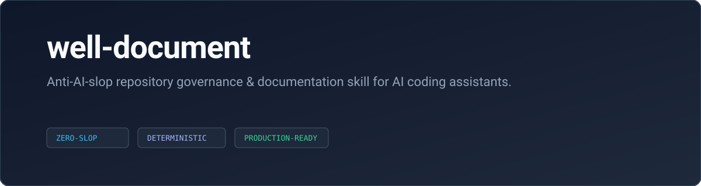

[← İngilizce Orijinalini Oku](../../README.md)

<div align="center">



# well-document

**Yapay zeka kodlama asistanları için anti-slop depo yönetimi ve teknik dokümantasyon yeteneği.**

[](../../LICENSE)
[](../../.github/workflows/ci.yml)
[](../../skills/well-document/SKILL.md)
[](#roadmap)
[](../../CONTRIBUTING.md)

</div>

---

## Genel Bakış

`well-document`, ham ve dokümantasyonsuz kod depolarını açık kaynak standartlarında, doğrulanabilir ve üretime hazır projelere dönüştüren açık kaynaklı bir yapay zeka ajan yeteneğidir. Cursor, Claude Code, Google Antigravity, Windsurf ve özel ajan akışlarıyla tam uyumlu çalışır.

Emoji kirliliği ve pazarlama jargonu üreten geleneksel şablon araçlarının aksine `well-document`; yapısal disiplin, gerçek teknik spesifikasyonlar ve endüstri standardı yönetim kuralları uygular.

---

## İçindekiler

- [Genel Bakış](#genel-bakış)
- [Teknik Özellikler](#teknik-özellikler)
- [Kurulum](#kurulum)
  - [Ajan Uyumluluk Matrisi](#ajan-uyumluluk-matrisi)
  - [Seçenek 1: Skills CLI (Önerilen)](#seçenek-1-skills-cli-önerilen)
  - [Seçenek 2: Tek Satırlık POSIX Kurulumu](#seçenek-2-tek-satırlık-posix-kurulumu-macos-ve-linux)
  - [Seçenek 3: PowerShell Kurulumu](#seçenek-3-powershell-kurulumu-windows-powershell-ve-cmd)
  - [Seçenek 4: Manuel Ajan Yapılandırması](#seçenek-4-manuel-ajan-yapılandırması)
  - [Güncelleme](#güncelleme)
- [Hızlı Başlangıç ve Kullanım Senaryoları](#hızlı-başlangıç-ve-kullanım-senaryoları)
- [Depo Mimarisi](#depo-mimarisi)
- [Sıkça Sorulan Sorular](#sıkça-sorulan-sorular)
- [Dokümantasyon](#dokümantasyon)
- [Lisans](#lisans)

---

## Teknik Özellikler

- **Pazarlama Jargonu Yasağı**: İçi boş niteleyicileri ayıklar. Yerine somut teknik mimari tanımları ve sözleşmeler koyar.
- **Sıkı Emoji Disiplini**: Gövde metinlerindeki gereksiz emojileri tamamen kaldırır. Ana başlıklarda yalnızca görsel ayrım sağlayan nötr simgeler kullanılabilir.
- **Fiziki Doğrulama (Grounding)**: Dokümantasyon yayılmadan önce referans verilen tüm dosya yollarının, paket komutlarının ve bağımlılıkların diskte fiziki olarak var olduğunu denetler.
- **Arketip Farkındalığı**: Projenin arabirim türüne göre en uygun dokümantasyon yapısını otomatik belirler:
  - **CLI Aracı**: Bayraklar, kabuk boru hatları, alt komutlar, yapılandırma şemaları.
  - **Kütüphane / SDK**: API yüzeyi, tipli kod blokları, çalışma zamanı matrisleri.
  - **Web / Arka Plan Servisi**: Docker, ortam değişkenleri (`.env.example`), veritabanı geçişleri, uç noktalar ve test koşullu Bruno/Postman API koleksiyonları.
  - **Monorepo**: Çalışma alanı haritaları, topolojik derleme sıraları.
  - **Makine Öğrenimi / AI**: Model kartları, SHA-256 sağlama toplamlı veri kümesi manifestoları, VRAM limitleri, W&B konfigürasyonları.
  - **Gömülü Sistemler / Donanım**: Mikrodenetleyici pinout tabloları, Flash/SRAM bellek haritaları, araç zincirleri, şematikler, flash komutları.
- **Yönetim Standartları**: Özel güvenlik açığı bildirim protokolleri (48 saat yanıt taahhüdü) ve Conventional Commits kuralları uygular.
- **Kullanıcı Onaylı İskelet**: Depoya tek taraflı dosya eklemez. Önerilen yönetim belgelerini gerekçeleriyle listeler ve kullanıcı açık onay vermeden diske yazmaz.

---

## Kurulum

`well-document` sisteminizdeki ajan dizinlerine genel olarak kurulabilir ya da doğrudan belirli bir proje deposuna bağlanabilir.

### Ajan Uyumluluk Matrisi

| Yapay Zeka Ajan Ortamı | Genel Yetenek Dizini | Proje Düzeyi Dizin | Durum |
| :--- | :--- | :--- | :---: |
| **Google Antigravity / Gemini CLI** | `~/.gemini/antigravity/skills/` | `.gemini/skills/` | Doğrulandı |
| **Claude Code** | `~/.claude/skills/` | `.claude/skills/` | Doğrulandı |
| **Cursor** | `~/.cursor/skills/` | `.cursor/skills/` | Doğrulandı |
| **OpenAI Codex / Copilot CLI** | `~/.codex/skills/` | `.codex/skills/` | Doğrulandı |

---

### Seçenek 1: Skills CLI (Önerilen)

Cursor, Claude Code, Antigravity ve Codex ortamlarında yetenek yönetimi için paket yöneticisi standardı:

```bash
# Add to current workspace/project repository
npx skills add AtaCanYmc/well-document

# Install globally across all detected AI agents on your machine
npx skills add AtaCanYmc/well-document -g

# Install non-interactively to specific agents
npx skills add AtaCanYmc/well-document --agent cursor claude-code antigravity -y
```

---

### Seçenek 2: Tek Satırlık POSIX Kurulumu (macOS ve Linux)

Harici bağımlılık gerektirmeyen doğrudan kabuk yükleyicisi:

```bash
# Auto-detect all installed agent environments
curl -fsSL https://raw.githubusercontent.com/AtaCanYmc/well-document/main/install.sh | sh

# Or install for a specific agent target:
curl -fsSL https://raw.githubusercontent.com/AtaCanYmc/well-document/main/install.sh | sh -s -- --antigravity
curl -fsSL https://raw.githubusercontent.com/AtaCanYmc/well-document/main/install.sh | sh -s -- --claude
curl -fsSL https://raw.githubusercontent.com/AtaCanYmc/well-document/main/install.sh | sh -s -- --cursor
curl -fsSL https://raw.githubusercontent.com/AtaCanYmc/well-document/main/install.sh | sh -s -- --codex
curl -fsSL https://raw.githubusercontent.com/AtaCanYmc/well-document/main/install.sh | sh -s -- --all
```

---

### Seçenek 3: PowerShell Kurulumu (Windows PowerShell ve CMD)

Windows ortamları için bağımsız yükleyici:

```powershell
# In PowerShell (Auto-detect all installed agent environments):
irm https://raw.githubusercontent.com/AtaCanYmc/well-document/main/install.ps1 | iex

# Or in Windows CMD:
powershell -ExecutionPolicy Bypass -Command "irm https://raw.githubusercontent.com/AtaCanYmc/well-document/main/install.ps1 | iex"

# Or install for a specific agent target (PowerShell):
& ([scriptblock]::Create((irm https://raw.githubusercontent.com/AtaCanYmc/well-document/main/install.ps1))) -Antigravity
& ([scriptblock]::Create((irm https://raw.githubusercontent.com/AtaCanYmc/well-document/main/install.ps1))) -Claude
& ([scriptblock]::Create((irm https://raw.githubusercontent.com/AtaCanYmc/well-document/main/install.ps1))) -Cursor
& ([scriptblock]::Create((irm https://raw.githubusercontent.com/AtaCanYmc/well-document/main/install.ps1))) -Codex
& ([scriptblock]::Create((irm https://raw.githubusercontent.com/AtaCanYmc/well-document/main/install.ps1))) -All

# Or run locally from cloned repository:
.\install.ps1
```

---

### Seçenek 4: Manuel Ajan Yapılandırması

#### 1. Google Antigravity ve Gemini CLI
`well-document` yeteneğini genel veya proje düzeyindeki yetenek yolunuza ekleyin:
```bash
# Global Antigravity skills directory
mkdir -p ~/.gemini/antigravity/skills/well-document
git clone https://github.com/AtaCanYmc/well-document.git ~/.gemini/antigravity/skills/well-document

# Or as a workspace-specific skill in your active repository:
mkdir -p .gemini/skills/well-document
cp -r path/to/well-document/* .gemini/skills/well-document/
```

#### 2. Claude Code
Claude Code yetenek envanterine ekleyin:
```bash
# Global skills directory
mkdir -p ~/.claude/skills/well-document
git clone https://github.com/AtaCanYmc/well-document.git ~/.claude/skills/well-document

# Or repository-scoped rules
mkdir -p .claude/skills/well-document
cp -r path/to/well-document/* .claude/skills/well-document/
```

#### 3. Cursor
Cursor kural veya yetenek dizinine ekleyin:
```bash
# Global Cursor skill definition
mkdir -p ~/.cursor/skills/well-document
git clone https://github.com/AtaCanYmc/well-document.git ~/.cursor/skills/well-document

# Project-level Cursor rules (.cursorrules / .cursor/rules)
mkdir -p .cursor/skills/well-document
cp -r path/to/well-document/* .cursor/skills/well-document/
```

#### 4. OpenAI Codex ve GitHub Copilot
Codex talimat yoluna bağlayın:
```bash
# Global Codex instruction path
mkdir -p ~/.codex/skills/well-document
git clone https://github.com/AtaCanYmc/well-document.git ~/.codex/skills/well-document

# Or specify as a prompt instruction file:
export CODEX_INSTRUCTION_PATH="$HOME/.codex/skills/well-document/SKILL.md"
```

---

### Güncelleme

Kullandığınız kurulum yöntemine uygun güncelleme komutunu çalıştırın:

```bash
# Skills CLI
npx skills update

# POSIX (macOS & Linux)
curl -fsSL https://raw.githubusercontent.com/AtaCanYmc/well-document/main/install.sh | sh

# Windows (PowerShell)
irm https://raw.githubusercontent.com/AtaCanYmc/well-document/main/install.ps1 | iex

# Manual Git clone (Antigravity example)
git -C ~/.gemini/antigravity/skills/well-document pull
```

---

## Hızlı Başlangıç ve Kullanım Senaryoları

Kurulum tamamlandıktan sonra yapay zeka asistanınızda `well-document` komutunu çalıştırın:

### Senaryo 1: Ham Bir Kod Deposunu Yapılandırma

> **İstem:** `"well-document init"`

Ajan proje bildirimlerinizi (`package.json`, `Cargo.toml`, `pyproject.toml`, vb.) inceler, depo arketipini belirler, aday yönetim belgelerini gerekçeleriyle sunar, onayınızı alır ve yalnızca onaylanan varlıkları üretir:
- Temiz ve arketipe özel `README.md`
- Çalışma zamanına uygun kapsamlı `.gitignore`
- Yapılandırılmış güvenlik politikası (`SECURITY.md`)
- Conventional Commits standartlarında `CONTRIBUTING.md`
- Standart açık kaynak lisansı (`LICENSE`)
- Gerçek hedeflere dayalı `ROADMAP.md`
- Backend/API rotaları tespit edildiğinde onaylı `bruno/` veya `postman/` koleksiyonları ve çalıştırılabilir yanıt test koşulları

### Senaryo 2: Mevcut Depo Dokümantasyonunu Denetleme

> **İstem:** `"well-document audit"`

Mevcut dokümantasyonunuzu 6 değerlendirme kapısına göre inceler ve dosyalarda izinsiz değişiklik yapmadan somut bir denetim raporu sunar.

### Senaryo 3: AI-Slop İçeren Dokümanı Sadeleştirme

> **İstem:** `"well-document polish README.md"`

Gereksiz emojileri, pazarlama cümlelerini ve çalıştırılamayan komutları ayıklar; yerlerine teknik mimari tanımları ve doğrulanmış komut blokları yerleştirir.

### Senaryo 4: İnteraktif Terminal Önizlemesi

> **İstem:** `"well-document preview README.md"`

Dokümantasyonun ANSI biçimlendirmeli önizlemesini terminalde gösterir ve 6 denetim kapısını gerçek zamanlı puanlayarak skor kartı basar.

### Senaryo 5: Çok Dilli Dokümantasyon Senkronizasyonu

> **İstem:** `"well-document i18n --init tr"`

Kod bloklarını ve başlık hiyerarşisini birebir koruyan çeviri şablonu çıkarır ya da mevcut çeviriyi denetler:

```bash
python3 scripts/sync-i18n.py --source README.md --target docs/translations/README.tr.md --lang tr --audit
```

---

## Depo Mimarisi

```text
.
├── .github/
│   ├── ISSUE_TEMPLATE/              # GitHub issue forms (bug reports, feature requests & config)
│   ├── PULL_REQUEST_TEMPLATE/       # Standardized pull request template
│   ├── CODEOWNERS                   # PR review responsibility assignment
│   ├── dependabot.yml               # Automated weekly dependency updates
│   └── workflows/
│       ├── ci.yml                   # Continuous integration (syntax, governance, anti-slop)
│       ├── owner-auto-merge.yml     # Automated squash merge for repository owner PRs
│       ├── release-please.yml       # Automated CHANGELOG & semantic versioning releases
│       └── well-document-gate.yml   # Reusable anti-slop and governance gate workflow
├── .claude-plugin/                  # Claude Code plugin manifest
├── .cursor-plugin/                  # Cursor plugin manifest
├── .editorconfig                    # Universal IDE & editor formatting rules
├── .gitattributes                  # Git line-ending normalization & export filters
├── .markdownlint.json               # Markdown lint rules (relaxed for tables, Mermaid & HTML)
├── .pre-commit-hooks.yaml           # Pre-commit framework hooks (grounding & anti-slop)
├── package.json                     # Skills CLI & npm package manifest
├── plugin.json                      # Google Antigravity & Gemini CLI plugin manifest
├── scripts/
│   ├── preview.py                   # Interactive terminal markdown preview & audit inspector
│   ├── sync-i18n.py                 # Multi-lingual documentation synchronizer and auditor
│   ├── verify-anti-slop.py          # Standalone anti-slop and emoji hygiene scanner
│   └── verify-grounding.py          # Standalone markdown relative link grounding validator
├── skills/
│   └── well-document/
│       ├── README.md                # Scoped subfolder documentation for the skill distribution
│       ├── SKILL.md                 # Primary AI agent skill definition & instructions
│       └── references/              # Knowledge bases loaded by the agent
│           ├── anti-patterns.md     # Catalog of AI-slop documentation tells & fixes
│           ├── archetypes.md        # Layout standards (CLI, Library, Web, ML, Embedded)
│           ├── automation.md        # CI/CD, Dependabot, Release Please & Issue/PR templates
│           ├── diagrams.md          # Technical Mermaid diagram standards & anti-slop rules
│           ├── i18n.md              # Multi-lingual documentation anti-slop guidelines
│           ├── licensing.md         # Open-source legal triage & dependency compatibility matrix
│           └── slop-test.md         # 6-point pre-emit audit scorecard
├── install.ps1                      # Windows PowerShell / CMD installer
├── install.sh                       # Portable POSIX shell installer
├── docs/
│   ├── recipes.md                   # Advanced recipes (CI actions, pre-commit, monorepos)
│   ├── screenshots/                 # Asset guidelines & banner assets
│   └── translations/                # Localized documentation mirrors
├── CHANGELOG.md                     # Semantic version release history
├── CONTRIBUTING.md                  # Contribution standards & Conventional Commits
├── SECURITY.md                      # Vulnerability disclosure policy
├── ROADMAP.md                       # Version milestones
└── LICENSE                          # MIT License
```

---

## Sıkça Sorulan Sorular

#### well-document kod parçalarını veya telemetri verilerini dış sunuculara gönderir mi?
Hayır. `well-document` tamamen yerel markdown kurallarından ve referans özelliklerden oluşan statik bir ajandır. Tüm analiz ve üretim adımları yerel makinenizde yürütülür; harici sunuculara telemetri veya kod aktarımı yapılmaz.

#### Bu aracın geleneksel şablon üreticilerden (Cookiecutter, Yeoman) farkı nedir?
Geleneksel araçlar katı metin şablonlarını kopyalar ve genellikle var olmayan klasörler oluşturur. `well-document` ise yapay zeka asistanınıza gerçek dosya ağacını denetleme, giriş noktalarını saptama ve gerçek kod yapınızı yansıtan özel dokümantasyon üretme protokolü sağlar.

#### Mühendislik ekibimiz özel anti-slop kuralları tanımlayabilir mi?
Evet. Bu depoyu fork edebilir veya bağlayabilirsiniz. `skills/well-document/references/anti-patterns.md` dosyasını düzenleyerek ekibinize özel yasaklı terimleri veya kurum içi CI kontrol noktalarını tanımlayabilirsiniz.

#### npx skills add ile doğrudan kurulabilir mi?
Evet. `well-document` Agent Skills standardına uygundur. `npx skills add AtaCanYmc/well-document` komutuyla projeye veya `-g` bayrağıyla tüm makineye kurulabilir.

---

## Dokümantasyon

- [Katkı Kılavuzu](../../CONTRIBUTING.md)
- [Güvenlik Politikası](../../SECURITY.md)
- [Proje Yol Haritası](../../ROADMAP.md)
- [Sürüm Geçmişi (Changelog)](../../CHANGELOG.md)
- [Gelişmiş Tarifler](../../docs/recipes.md)

---

## Lisans

Bu proje MIT Lisansı altında lisanslanmıştır. Detaylar için [LICENSE](../../LICENSE) belgesine bakın.
