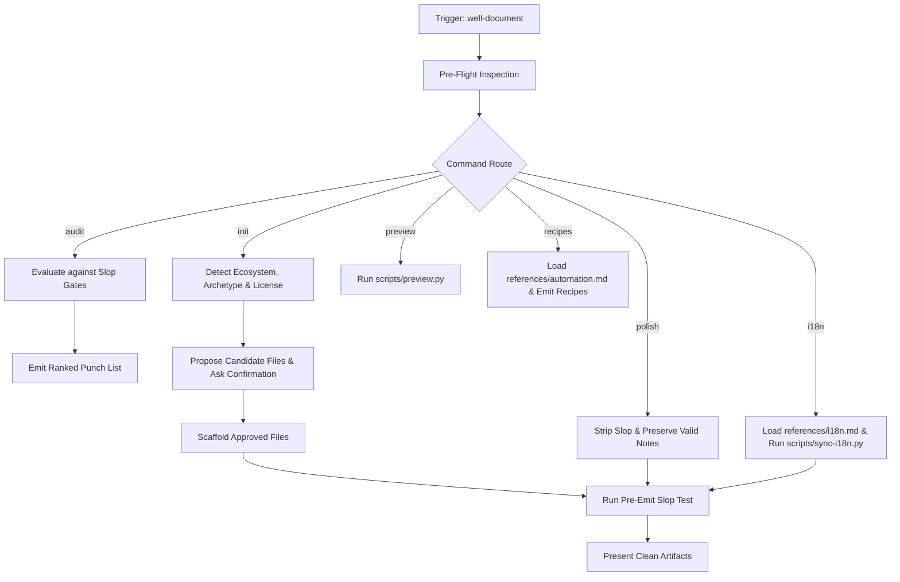

# well-document

A repository governance and documentation skill for AI coding assistants. Turns raw, undocumented codebases into clean, open-source repositories that look engineered, not generated.

`well-document` is opinionated, technical, and anti-AI-slop. It systematically replaces generic boilerplate, emoji clutter, and marketing puffery with crisp technical architecture, real verification steps, and industry-standard governance.

---

## Invocations & Verbs

`well-document` operates through explicit modular verbs:

| Invocation | Action |
| :--- | :--- |
| `well-document init` *(default)* | Scans the codebase, detects language and runtime signatures, proposes candidate files, and scaffolds approved governance files. |
| `well-document audit` | Inspects existing repository documentation against anti-AI-slop gates and returns a ranked punch list. **Makes no edits.** |
| `well-document polish <file>` | Rewrites a single documentation file to eliminate AI slop, prune filler adjectives, and inject technical precision while preserving valid human-written notes. |
| `well-document preview <file>` | Runs the local terminal preview script to render ANSI-styled documentation with a real-time 6-gate audit scorecard. |
| `well-document i18n <action>` | Scaffolds or audits multi-lingual documentation against translation drift, mangled code blocks, and localized marketing slop. |
| `well-document recipes` | Outputs concrete automation recipes for CI governance gates, pre-commit hooks, multi-package monorepos, and release workflows. |

---

## Core Philosophy: Anti-AI Slop for Documentation

AI-generated documentation is instantly recognizable by common tells: rocket emojis, "comprehensive and robust", "cutting-edge architecture", empty feature tables, and placeholder URLs that lead nowhere. `well-document` strictly forbids this.

### Non-Negotiable Rules

1. **Zero Emoji Vomit**: Emojis are strictly banned from body copy. A single neutral icon may appear next to top-level section headers only if it serves functional visual parsing. Never use `:rocket:`, `:fire:`, `:sparkles:`, or `:tada:` in technical docs.
2. **No Fabricated Metrics or Social Proof**: Never invent statistics such as *"99.9% uptime"* or *"trusted by 10,000 developers"*. If benchmarks do not exist in the code, omit the benchmark section and provide reproduction commands instead.
3. **No Fluff Adjectives**: Eliminate *effortless, seamless, revolutionary, blazingly fast, cutting-edge, robust, comprehensive, ultimate, elegant, battle-tested*. State the technical mechanics plainly.
4. **Actionable Quick Start**: Every code block in Quick Start must be copy-paste executable against the actual repository tree. If a command requires environment variables, name them explicitly and reference `.env.example`.
5. **Architectural Grounding**: Every directory listed in the file tree must physically exist in the repository. Never emit speculative or generic directory trees.
6. **Secret & Credential Hygiene**: Never copy real API keys, tokens, passwords, private endpoints, or internal IP addresses from local `.env` or config files into documentation or `.env.example`. Always emit sanitized placeholder values.
7. **Content Preservation**: When running `init` or `polish` on existing documentation, preserve valid human-written architectural decisions, domain warnings, and custom licensing notes. Strip only slop, broken references, and unverified claims.
8. **Visual Architecture via Mermaid**: When explaining subsystem interactions, data flows, protocols, or state transitions, embed concise, dark/light-compatible Mermaid diagrams using `flowchart`, `sequenceDiagram`, or `stateDiagram-v2`. See [`references/diagrams.md`](references/diagrams.md).
9. **High-Signal Technical FAQ**: Include a technical FAQ section only when the repository has distinct trade-offs, privacy guarantees, offline execution rules, or alternative comparisons. Forbid trivial filler questions such as *"Is this free?"*.
10. **Legal License Compatibility**: Never assign an incompatible permissive license if dependencies impose copyleft obligations like GPL or AGPL. Never emit unpopulated placeholders such as `<YEAR>` or `[fullname]`. Follow [`references/licensing.md`](references/licensing.md).
11. **CI, Maintenance & Release Automation**: Scaffold `.github/workflows/ci.yml` when runnable tests, linters, or build scripts exist. Scaffold `.github/dependabot.yml` when dependencies or actions exist. Scaffold `.github/workflows/release-please.yml` when Conventional Commits and versioned releases are used. Embed the CI status badge in `README.md`. See [`references/automation.md`](references/automation.md).
12. **Issue & Pull Request Governance**: For production repositories, scaffold `.github/ISSUE_TEMPLATE/` containing `config.yaml` with `blank_issues_enabled: false` and security redirects, `bug_report.yml`, and `feature_request.yml`. Scaffold `.github/PULL_REQUEST_TEMPLATE/pull_request_template.md` enforcing Conventional Commits and verification commands. See [`references/automation.md`](references/automation.md).
13. **Conditional Table of Contents**: Include a hyperlinked Table of Contents immediately after the Overview block when `README.md` contains 5 or more top-level sections. Omit it on short, single-purpose repositories to avoid vertical bloat.
14. **Scoped Subfolder READMEs**: When a repository contains discrete sub-packages, independent workspaces, or major domain modules such as `packages/*`, `apps/*`, `crates/*`, or `skills/*`, scaffold dedicated `README.md` files inside those subfolders. Each sub-README must document only that module's scope and include a top navigation link back to the root repository.
15. **No Long Dashes & Minimal Parentheses**: Avoid long dashes (`—` or `--`) to stitch fragmented thoughts together. Keep parenthetical explanations minimal. Write direct, declarative sentences terminated with periods. See [`references/anti-patterns.md`](references/anti-patterns.md).
16. **Fast-Path Quick Start for Containers**: When `docker-compose.yml`, `Dockerfile`, or `.devcontainer/` exists, lead `README.md` with a turnkey **Quick Start (Docker)** section limited to 3 or 4 executable commands. Never bury container commands beneath lengthy manual setup steps.
17. **Tabular Clarity for Structured Data**: Document environment variables, CLI flags, configuration schemas, and compatibility matrices in compact Markdown tables with explicit column alignment. See [`references/archetypes.md`](references/archetypes.md).
18. **User Confirmation Before Creation**: Never unilaterally scaffold unrequested files. Present an itemized checklist of candidate files with a one-sentence technical rationale for each, and generate only the files the user explicitly approves.
19. **Pre-Emit Slop Gate**: Run the 6-point verification scorecard in [`references/slop-test.md`](references/slop-test.md) before emitting or saving any documentation file.

---

## Execution Flow

### Step 0: Pre-Flight Inspection & Legal Triage

Before writing or editing any file, inspect the target repository:

- **Language & Runtime**: Detect package manifests including `package.json`, `Cargo.toml`, `pyproject.toml`, `go.mod`, and `pom.xml`.
- **Existing Governance**: Check for `LICENSE`, `README.md`, `CONTRIBUTING.md`, `SECURITY.md`, and `.gitignore`.
- **Public API & Entry Point**: Identify primary CLI commands, importable modules, or main entry points.
- **Infrastructure & Containers**: Detect `Dockerfile`, `docker-compose.yml`, or `.devcontainer/` to determine if a Docker Quick Start is warranted.
- **Sub-Packages & Workspaces**: Identify modular subdirectories such as `packages/`, `apps/`, `crates/`, or `skills/` requiring scoped documentation.
- **Upstream Licensing Triage**: Scan dependencies for copyleft constraints, determine the distribution model, and extract the author or organization identity. See [`references/licensing.md`](references/licensing.md).

### Step 1: Select Repository Archetype

Choose the structure matching the codebase's true interface in [`references/archetypes.md`](references/archetypes.md):

- **Library / SDK**: API surface, minimal dependencies, typed examples, package manager installation.
- **CLI Utility**: Command-line usage, flags, subcommands, shell pipelines, configuration files.
- **Service / Web App**: Local setup, environment table, database migrations, container execution.
- **Monorepo / Multi-Package**: Workspace topologies, shared packages, topological build commands.
- **Machine Learning / AI**: Model cards, dataset checksums, training and evaluation pipelines, VRAM requirements, experiment tracking.
- **Hardware & Embedded**: Microcontroller specs, pinout tables, memory maps, toolchains, schematics, and flashing instructions.

### Step 2: Propose & Assemble Governance Files (`init`)

Before writing any file to disk:

1. Present an itemized list of candidate files with a one-sentence technical rationale for each.
2. Ask the user for explicit confirmation: *"Here are the recommended documentation and governance files for your project. Which of these would you like to create?"*
3. Generate only the approved files.

Standard candidate assets:

- **`README.md`**: Minimalist header with CI badge, single-sentence technical definition, conditional Table of Contents, actionable Quick Start, grounded architecture tree, verifiable examples, and conditional FAQ.
- **Scoped Subfolder `README.md`**: Independent module documentation with localized Quick Start, API surface, and root navigation breadcrumb.
- **`.gitignore`**: Complete ignore rules for detected runtimes, IDEs, OS metadata, and secret files.
- **`.gitattributes`**: Cross-platform LF normalization, binary asset protection, and release archive exclusions.
- **`SECURITY.md`**: Active version support table, private disclosure workflow, and 48-hour response SLA.
- **`CONTRIBUTING.md`**: Conventional Commits specification, branch naming, local test commands, and PR checklist.
- **`LICENSE`**: Legally compatible open-source license with accurate calendar year and copyright owner.
- **`ROADMAP.md`**: Concrete milestones grouped by version tags without speculative promises.
- **`.markdownlint.json` & `.editorconfig`**: Disciplined Markdown linting and universal IDE formatting rules.
- **`.github/CODEOWNERS`, `ISSUE_TEMPLATE/`, `PULL_REQUEST_TEMPLATE/`**: Structured issue forms, PR templates, and review ownership.
- **Automation Workflows**: Conditional `ci.yml`, `well-document-gate.yml`, `dependabot.yml`, `release-please.yml`, `owner-auto-merge.yml`, and `.pre-commit-hooks.yaml`.

### Step 3: Auxiliary Command Routes (`preview`, `i18n`, `recipes`)

Resolve bundled Python scripts relative to the skill installation directory if they do not exist in the target repository.

- **`well-document preview <file>`**: Execute `python3 <skill-dir>/scripts/preview.py <file>` to render the terminal preview and 6-gate audit scorecard. If Python or the script is unavailable, run the 6-gate scorecard manually using [`references/slop-test.md`](references/slop-test.md).
- **`well-document i18n <action>`**: Load [`references/i18n.md`](references/i18n.md) before translating or auditing. Run `python3 <skill-dir>/scripts/sync-i18n.py` to scaffold translation templates with verbatim code blocks or audit structural parity against the source file.
- **`well-document recipes`**: Load [`references/automation.md`](references/automation.md) and emit copy-pasteable configurations for CI governance gates, pre-commit hooks, monorepo documentation layouts, or release automation tailored to the target repository.

### Step 4: Self-Critique & Pre-Emit Verification

Score all generated or modified documentation against the 6 gates in [`references/slop-test.md`](references/slop-test.md):

1. **Verifiability**: Can the Quick Start be executed verbatim?
2. **Brevity**: Are introductory paragraphs and cheerleading eliminated?
3. **Restraint**: Is emoji usage zero or strictly minimal?
4. **Accuracy**: Does the file tree match the real repository layout?
5. **Security**: Are disclosure instructions private and free of leaked secrets?
6. **Governance**: Are PR requirements and commit formats stated clearly?
